# Ciki

English | [中文](./README.md)

Ciki is an internal team wiki: pages are organized by space and in a tree, with multi-member collaboration, version history and full-text search. A single Cloudflare Workers deployment unit serves both the API and the frontend static assets; data lives in D1 and images in R2.

## Screenshots

| Reading view (code blocks and tables)               | Editor                                        |
| --------------------------------------------------- | --------------------------------------------- |
| 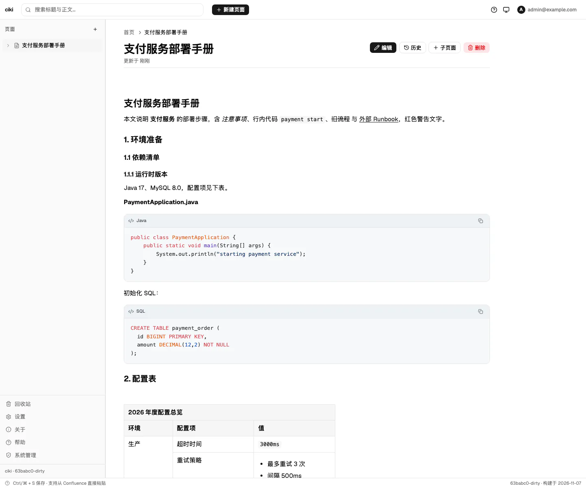 | 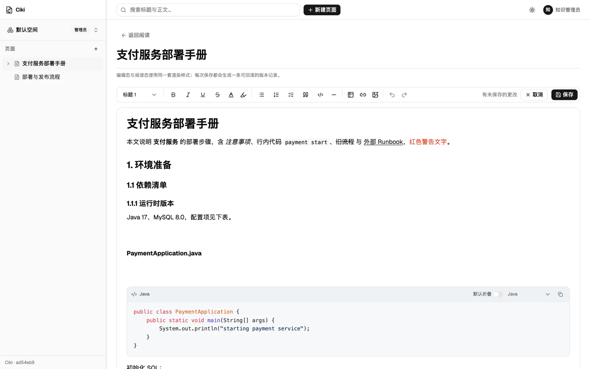 |

| Page tree (three levels)                         | Search                                     |
| ------------------------------------------------ | ------------------------------------------ |
| 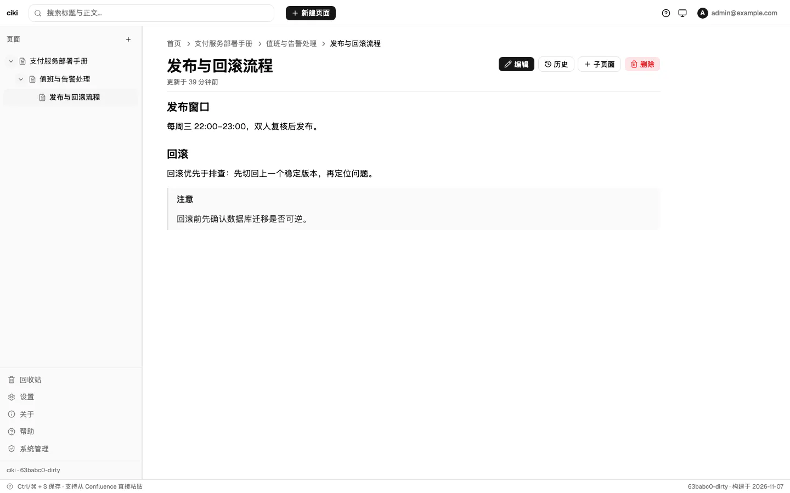 | 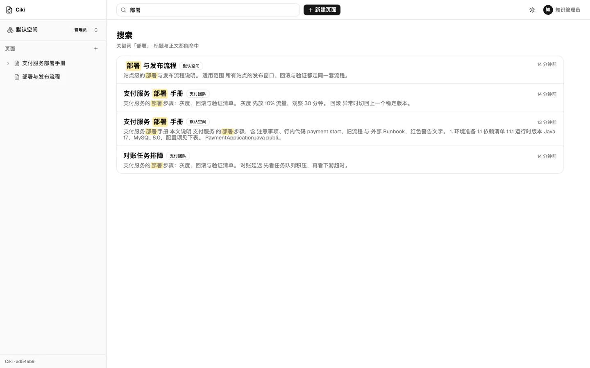 |

| Space switcher                                                            | Space settings and members                                                |
| ------------------------------------------------------------------------- | ------------------------------------------------------------------------- |
| 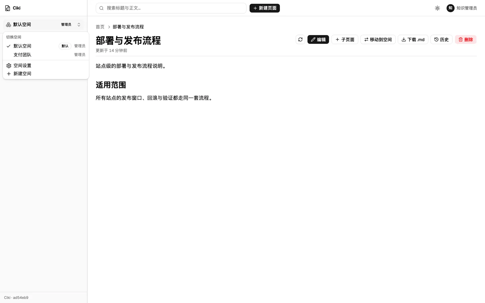 | 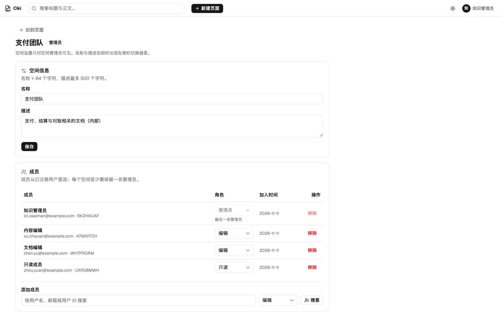 |

| Login                                    | Mobile reading                             |
| ---------------------------------------- | ------------------------------------------ |
| 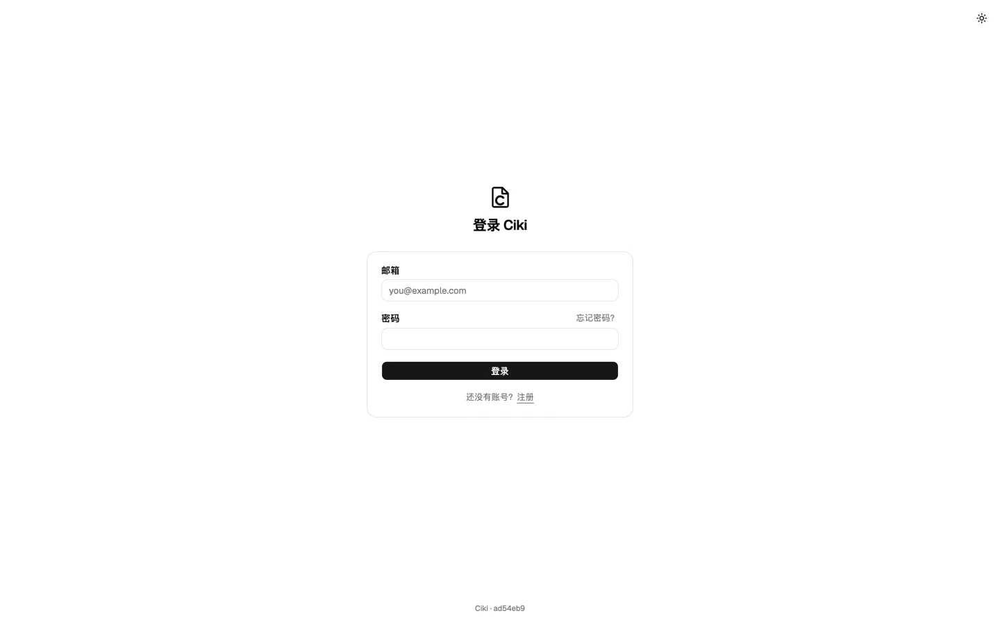 | 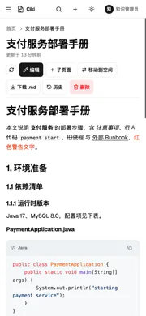 |

| Settings (theme and two-factor)                | Admin panel                                    |
| ---------------------------------------------- | ---------------------------------------------- |
| 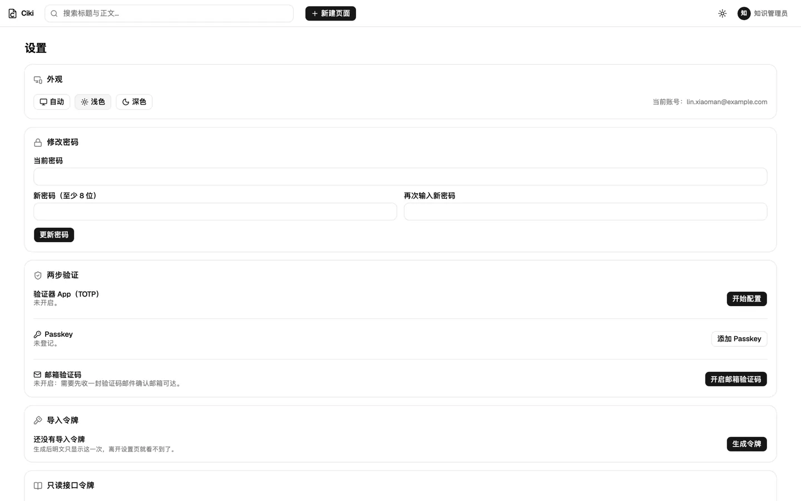 | 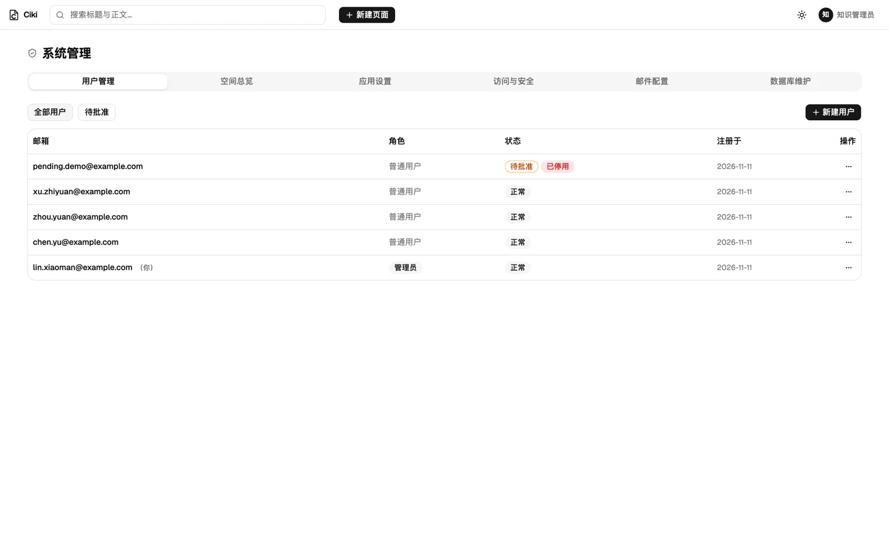 |

| Dark theme                                             | About (build info)                       |
| ------------------------------------------------------ | ---------------------------------------- |
| 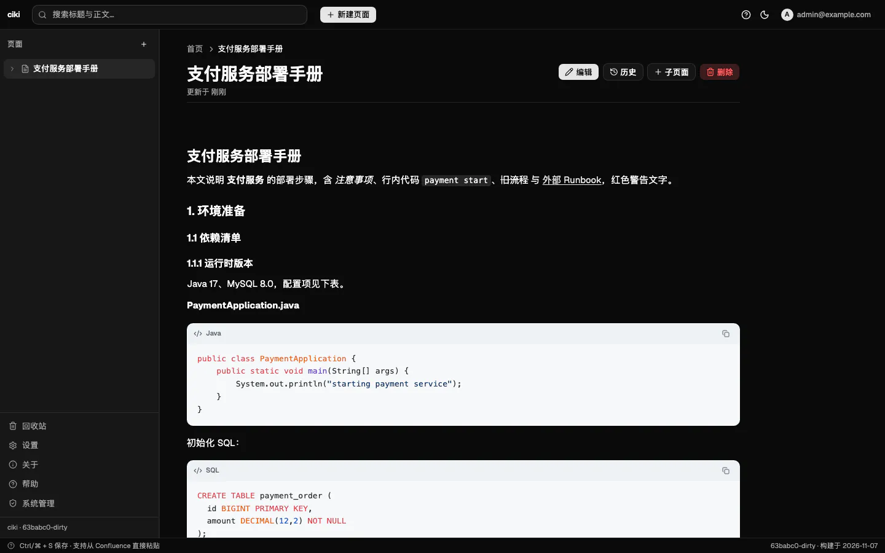 | 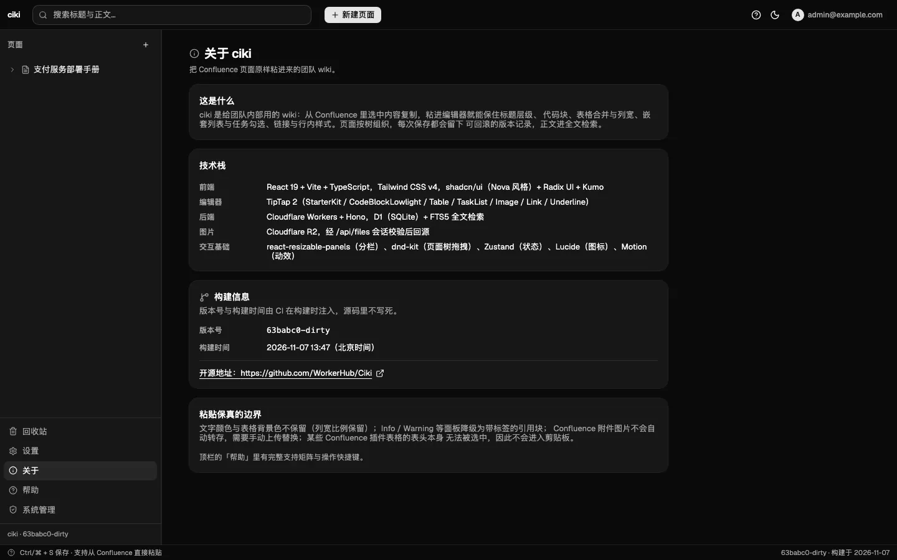 |

Screenshots were captured from a local run (`wrangler dev` with a local D1/R2); all sample content is fictional.

## Features

- **Spaces and member roles** — Every space has its own member list with `admin`, `editor` and `viewer` roles. Regular users only see spaces they belong to; site admins see all of them.
- **Page tree** — A tree in the sidebar; drag to change hierarchy and order. Pages can move within a space, and a whole subtree can move to another space.
- **Editor** — TipTap 2. Code blocks get light syntax highlighting, a language badge and a copy button (identical in edit and reading views), table columns are resizable, and images upload straight to R2.
- **Version history** — Every save creates a version record; open an old version and roll back. A rollback is itself recorded as a new version.
- **Full-text search** — Search from the top bar matches both titles and bodies via FTS5 with CJK tokenization; results include snippets.
- **Trash** — Deleting a page soft-deletes its whole subtree; restore it or delete it permanently. Permanent deletion also removes the version history.
- **Login and two-factor auth** — Password plus TOTP / Passkey. The first registered user becomes an admin automatically; later registrations need admin approval by default. Adding a second factor requires re-entering the password once.
- **Import tokens** — Generate a personal token in Settings and use the companion Ciki Helper browser extension to clip source pages into Ciki (title, body, code blocks, tables and images). The token plaintext is shown only once.
- **Settings** — Appearance (light / dark / system, no first-paint flash), password change, two-factor auth, import token, signed-in devices.
- **Admin panel** — Users and registration approval, space overview, site settings (site name, open registration, registration approval, setup page toggle), access and security (enforce two-factor), database maintenance.
- **About** — Version and build time, injected by CI at build time.
- **Mobile-friendly** — Responsive layout; reading, page tree and space switching work on phones.

## Tech Stack

- **Backend**: Cloudflare Workers + Hono (TypeScript), D1 (SQLite) + FTS5 full-text search
- **Frontend**: React 19 + Vite + TypeScript, Tailwind CSS v4, shadcn/ui (Nova style) + Kumo + Radix UI
- **Editor**: TipTap 2 (StarterKit / CodeBlockLowlight / Table / TaskList / Image / Link / Underline)
- **Storage**: D1 for pages, versions and users; R2 for images; the Worker also serves the frontend static assets
- **Interaction**: react-resizable-panels (split panes), dnd-kit (page tree drag and drop), Zustand (state), Lucide (icons), Motion (animation)
- **Tooling and deployment**: pnpm monorepo, GitHub Actions + Wrangler
- **API contract**: see [`docs/api-contract.md`](docs/api-contract.md)

## Deployment Guide

The steps below follow: clone → create resources → configure Secrets → deploy → initialize → register the admin. All you need is a Cloudflare account and a GitHub repository; no long-running local service is required.

### Prerequisites

- A Cloudflare account with Workers, D1 and R2 enabled (R2 must be enabled in the dashboard the first time)
- A GitHub account, with the repository forked or copied to your own account (the deploy workflow runs from that repository's Actions)
- Git on your machine (when deploying only through GitHub Actions, it is the only local tool you need, for cloning the repository)
- Node.js 22 or later and pnpm for local development (`corepack enable` picks up the pnpm version pinned by the repository)

### 1. Clone the repository

```bash
git clone https://github.com/<your-github-account>/Ciki.git
cd Ciki
```

If you have write access to the upstream repository, use `https://github.com/WorkerHub/Ciki.git` instead.

If you only deploy through GitHub Actions, this is all you need. To run the app locally first, run `pnpm install` (see "Local Development").

### 2. Create Cloudflare resources

**D1 database** (pages, versions, users and other data)

- Open the Cloudflare dashboard → Storage & Databases → D1 SQL Database → Create database, and name it `ciki` (any name works).
- Open the database afterwards and note its **Database name** and **Database ID**; you will enter them in the next step.
- Ciki's table names carry the `ciki_` prefix by default, so you can reuse an existing D1 database without colliding with other projects in it.

**R2 bucket** (images)

- The bucket name is fixed to `ciki-assets` (set in `worker/wrangler.toml` and in the deploy workflow).
- The deploy workflow creates it idempotently: it creates the bucket when missing and skips it when present. You can also create it up front under R2 Object Storage → Create bucket; the name must be `ciki-assets`.
- The `CLOUDFLARE_API_TOKEN` used for deployment needs **R2 edit** permission; otherwise the bucket step fails the deployment (nothing has been deployed at that point).

### 3. Configure GitHub Secrets and Variables

Open the repository's Settings → Secrets and variables → Actions. Keep resource IDs in **Secrets** (GitHub masks them automatically); non-secret values such as the database name and table prefix go in **Variables**.

**Secrets** (Secrets tab → New repository secret, one at a time)

| Secret                  | Purpose                                                                                                                                                                                                                                                                |
| ----------------------- | ---------------------------------------------------------------------------------------------------------------------------------------------------------------------------------------------------------------------------------------------------------------------- |
| `CLOUDFLARE_API_TOKEN`  | Cloudflare API token. The "Edit Cloudflare Workers" template works; make sure the permissions include Workers Scripts edit, D1 edit and R2 edit (add whichever is missing)                                                                                             |
| `CLOUDFLARE_ACCOUNT_ID` | Cloudflare account ID (copy it from the right side of the dashboard home page)                                                                                                                                                                                         |
| `D1_DATABASE_ID`        | The D1 Database ID noted in the previous step                                                                                                                                                                                                                          |
| `ENCRYPTION_KEY`        | AES-GCM key for TOTP secrets, 32 bytes, generated with `openssl rand -base64 32` (64-char hex also works). Store a copy in your password manager first; do not change it after deploying, or every enrolled two-factor setup stops working and users must enroll again |
| `SETUP_SECRET`          | Token for database initialization, any random string, e.g. `openssl rand -hex 16`                                                                                                                                                                                      |

**Variables** (Variables tab → New repository variable)

| Variable           | Purpose                                                                                                                                 |
| ------------------ | --------------------------------------------------------------------------------------------------------------------------------------- |
| `D1_DATABASE_NAME` | D1 database name (plain text, not a secret)                                                                                             |
| `TABLE_PREFIX`     | Table prefix, optional. Unset or empty → `ciki_`; `none` → no prefix; any other value (e.g. `wiki`) → `wiki_`. See "Table prefix" below |

These five Secrets and two Variables are everything the deployment needs: `deploy.yml` references only these names. A missing item, a value still in template form (`*_PLACEHOLDER` / `replace-with-*`), or an `ENCRYPTION_KEY` that is not 32 bytes makes the deploy abort before uploading and name the offending item — no empty or placeholder value is ever substituted.

### 4. Deploy

Push to `main` (or merge a pull request): the repository's automated checks (CI) run first, and only a green run triggers the deploy. You can also trigger it manually from Actions → Deploy → Run workflow.

The deploy workflow does four things in order: build the frontend → resolve secrets and the `wrangler.toml` placeholders → create the R2 bucket when missing → `wrangler deploy`. It does not create tables; that happens in the next step.

### 5. Initialize the database

A successful deploy only means the Worker is live; the tables do not exist yet. Open the site: an uninitialized deployment redirects to the `/setup` page.

1. Enter `SETUP_SECRET` (it travels only in the `X-Setup-Secret` request header, never in the URL).
2. Submit; the endpoint only runs migrations and returns the effective table prefix and the list of migrations it ran. Check the prefix against your expectation.

You can also do it from the command line (input is not echoed and does not reach shell history):

```bash
read -rs SETUP_SECRET
curl -X POST https://<your-site-domain>/api/setup -H "X-Setup-Secret: $SETUP_SECRET"
unset SETUP_SECRET
```

After each upgrade deployment, an admin clicks "Check and upgrade database" under Admin → Database Maintenance (系统管理 → 数据库维护) to apply pending migrations (`POST /api/admin/setup` with an admin session; no `SETUP_SECRET` needed). Migrations are additive, already-applied ones show as `skipped`, and the UI offers no drop-table or wipe-database action.

### 6. Register the admin

Once initialization finishes, open the site and register an account. The first registered user becomes an admin, approved and active automatically; later registrations require admin approval by default. Change open registration and the approval requirement under Admin → Site Settings (系统管理 → 应用设置).

### Table prefix TABLE_PREFIX (optional)

All table names are built by `getTablePrefix()` in `worker/src/lib/table-prefix.ts`; `TABLE_PREFIX` only affects this project's tables, which makes it practical to share one D1 database with other projects.

| Setting                                                                                                                                                     | Effective prefix | Example table |
| ----------------------------------------------------------------------------------------------------------------------------------------------------------- | ---------------- | ------------- |
| Unset / empty (default)                                                                                                                                     | `ciki_`          | `ciki_pages`  |
| Custom value (e.g. `wiki`: must start with a letter or underscore, followed only by letters, digits and underscores; a trailing `_` is added automatically) | `wiki_`          | `wiki_pages`  |
| `none` (reserved word in GitHub Variables, meaning an explicit empty value)                                                                                 | no prefix        | `pages`       |

Decide the effective prefix before initialization: changing it later means a different, empty set of tables. If the database is already initialized under another prefix, the setup endpoint aborts with 409 instead of creating a second set of tables.

## Local Development

```bash
pnpm install
cp worker/.dev.vars.example worker/.dev.vars   # fill in local ENCRYPTION_KEY / SETUP_SECRET
pnpm dev
```

`pnpm dev` builds the frontend once (`web/dist` is the Worker's static asset directory), then starts both processes with `concurrently`:

- Worker: `wrangler dev`, default <http://localhost:8787>; local D1/R2 are emulated by miniflare, so no Cloudflare account is needed.
- Web: `vite`, default <http://localhost:5173>, proxying `/api` to 8787.

`worker/.dev.vars` is gitignored; real secrets never enter the repository. `TABLE_PREFIX` is optional: unset → `ciki_`, empty value → no prefix (the reserved word `none` is only translated by CI).

## Checks

```bash
pnpm lint          # biome lint
pnpm format:check  # biome format
pnpm typecheck     # web + worker
pnpm build         # frontend bundle + worker type check
pnpm test          # worker unit tests + web unit tests (vitest + jsdom)
pnpm check:deploy  # wrangler deploy --dry-run: validates bindings and bundling
```

CI runs these six in order. `check:deploy` confirms before deployment that all three binding kinds (D1 / R2 / static assets) resolve and that the Worker bundles; it does not upload or change any remote resources.

## Project Layout

```
.github/workflows/   CI (checks) and Deploy (deployment)
docs/                API contract and data model
scripts/             Deploy-time config resolution (table prefix states, secrets.json, wrangler.toml placeholders)
web/                 React + Vite frontend (build output web/dist served by the Worker)
worker/              Hono Worker (D1 / R2 / static asset bindings)
```

### Frontend code map

```
web/src/editor/paste/  External HTML cleaning pipeline (with fixtures and assertions)
web/src/editor/        TipTap extensions (shared by edit/read views), code block and image NodeViews, toolbar, extension bridge
web/src/lib/           API client (the only HTTP exit), column width conversion, page tree algorithms, theme, uploads
web/src/stores/        Zustand: session, page tree, spaces, theme
web/src/pages/         Reading/edit/search/trash/settings/about/admin/space settings/login/register/setup
```

## API and Data Model

The complete API, fields, error codes and migration notes live in [`docs/api-contract.md`](docs/api-contract.md).

- Every `/api/*` endpoint except public routes and the import endpoints requires the session cookie (`ciki_session`, HttpOnly / Secure / SameSite=Strict, sliding 7-day expiry).
- The import endpoints under `/api/import/*` accept only `Authorization: Bearer <personal import token>`, never a session cookie. Ciki Helper uses them to list writable spaces and parent pages, check for same-title pages, upload images and write pages. Generate the token in Settings; the plaintext is shown only once.
- Images are served from `/api/files/:key` and require a login session; there are no public links.

## License

[MIT](LICENSE)
