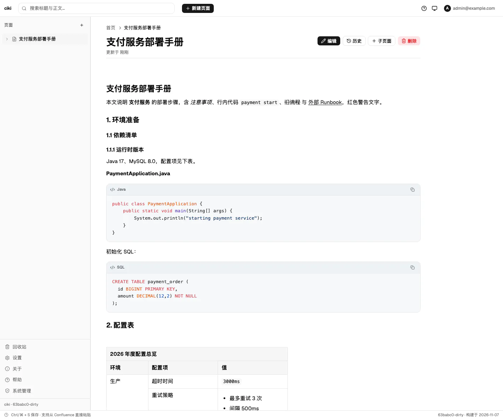
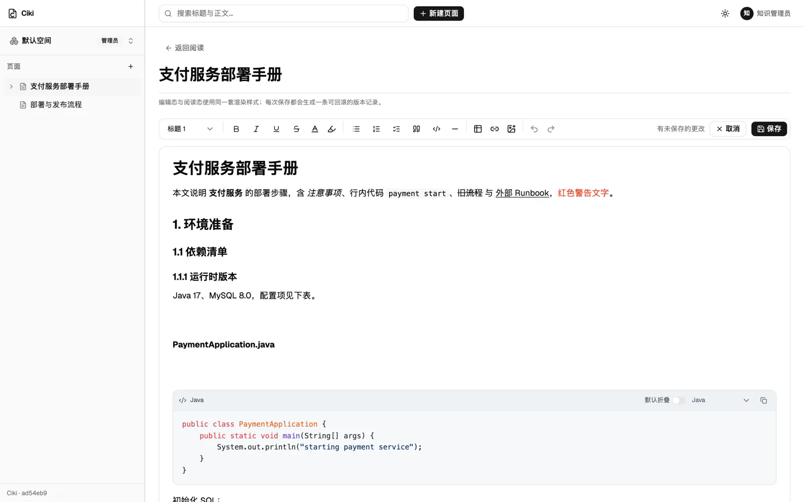
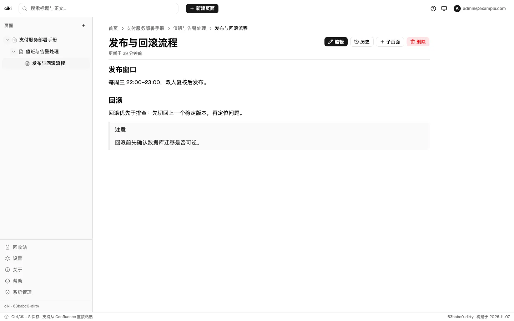
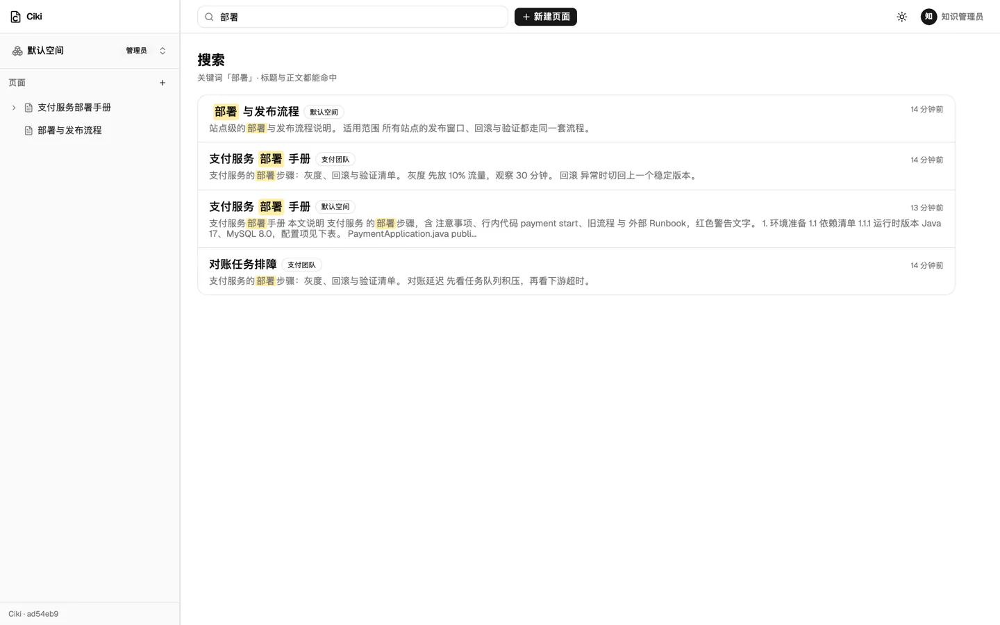
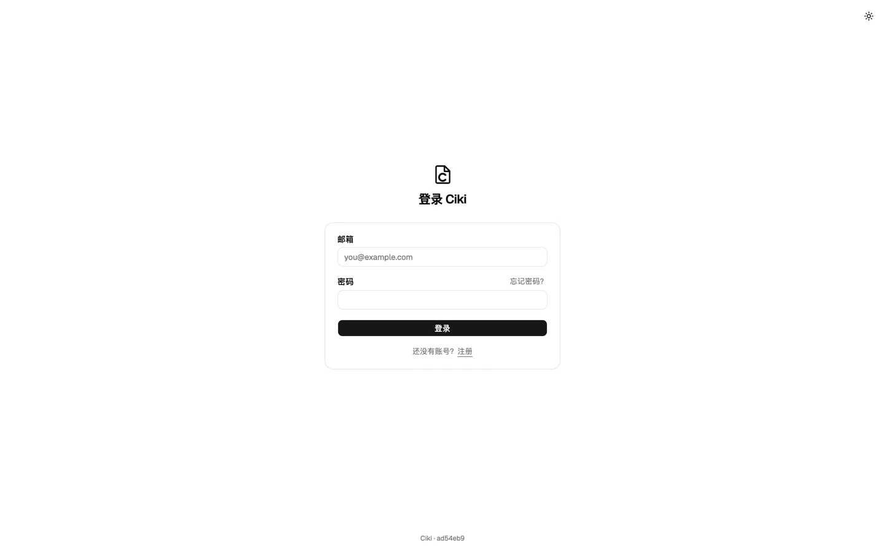
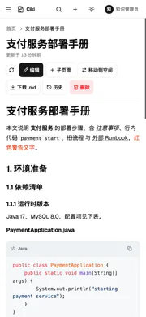
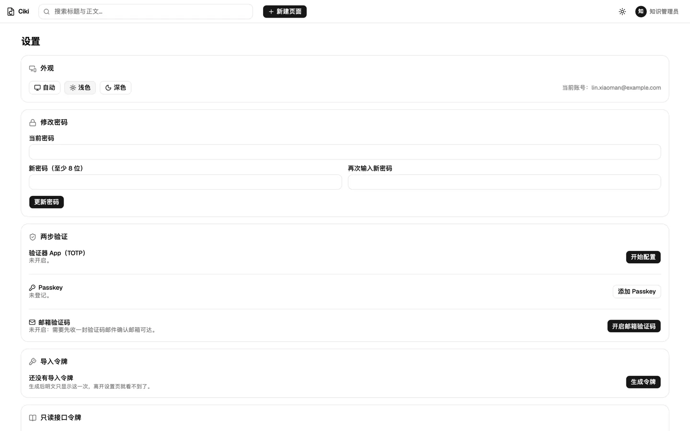
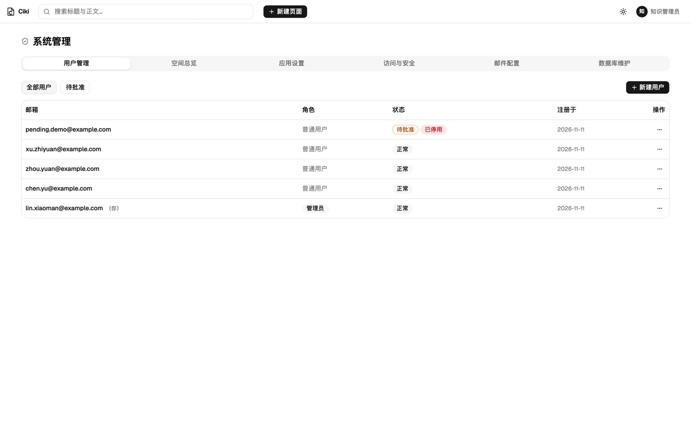
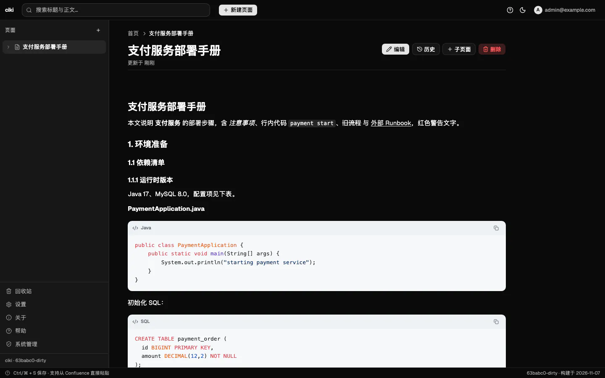
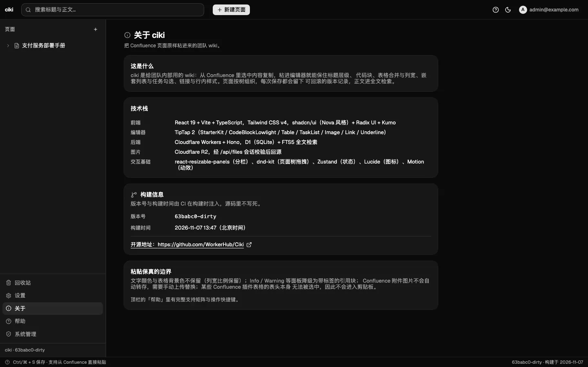

# ciki

团队成员用的 wiki：把 Confluence 页面原样粘进来，保真渲染（标题、代码块、表格、嵌套/任务列表、图片）。Cloudflare Workers + D1 + R2，一个部署单元同时托管 API 与前端静态资源。

## 技术栈

- `worker/` —— Hono + TypeScript，跑在 Cloudflare Workers；数据在共享 D1，图片在专用 R2 bucket。
- `web/` —— React + Vite + TypeScript；UI 用 shadcn/ui（Nova 风格）+ Kumo + Radix，图标 Lucide、动画 Motion、状态 Zustand、拖拽 dnd-kit、分栏 react-resizable-panels。
- pnpm monorepo；样式 Tailwind CSS v4。

接口与数据模型的冻结契约见 [`docs/api-contract.md`](docs/api-contract.md)；后端已落地鉴权（密码 + Passkey + TOTP）、setup/迁移、页面与版本、FTS5 搜索、图片接口，以及个人导入令牌与四个导入接口（`/api/import/*`，供 Confluence 插件用 Bearer 令牌调用）。

## 功能

- **粘贴保真**：从 Confluence 选中复制，粘进编辑器即保住标题层级、代码块（含阅读页「行号列」形态）、表格合并与列宽比例、嵌套列表与任务勾选、链接与行内样式（规格 §5）。
- **编辑器**：TipTap 2，代码块浅色高亮 + 语言角标 + 复制按钮（编辑态阅读态一致），表格可拖拽列宽，图片粘贴直传 R2。
- **页面树**：侧边栏树形组织，拖拽改层级/排序，新建、改名、软删、回收站恢复与彻底删除。
- **版本**：每次保存生成一条版本记录，可查看旧版并回滚（回滚本身也是一条新版本）。
- **搜索**：顶栏搜索框，标题与正文都命中，结果页给命中片段。
- **分区**：设置（主题 / 密码 / 两步验证 / Passkey / 导入令牌 / 登录设备）、关于（版本与构建信息）、系统管理（用户、应用设置、访问与安全、数据库维护）。
- **登录**：账号密码 + 两步验证（TOTP 单框 / Passkey），注册审批，setup 初始化引导；主题亮 / 暗 / 自动三档，首屏不闪烁。
- **两步验证管理**：已经有任一验证方式时，新增另一种（TOTP 或 Passkey）需要再输入一次账号密码重认证；一个都没有时直接配置。

### 界面预览

| 阅读页（代码块与表格）                        | 编辑页（粘贴 Confluence 内容）                |
| --------------------------------------------- | --------------------------------------------- |
|  |  |

| 页面树（三层）                                | 搜索                                     |
| --------------------------------------------- | ---------------------------------------- |
|  |  |

| 登录                                    | 移动端阅读                                 |
| --------------------------------------- | ------------------------------------------ |
|  |  |

| 设置（主题与两步验证）                     | 系统管理                                    |
| ------------------------------------------ | ------------------------------------------- |
|  |  |

| 深色主题                                             | 关于（构建信息）                        |
| ---------------------------------------------------- | --------------------------------------- |
|  |  |

截图是本地真跑（`wrangler dev` + 本地 D1/R2）录的，示例内容全部虚构。

### 粘贴支持与已知限制

完整支持矩阵也放在应用内「帮助」弹窗里：

- 保留：H1–H6、引用、分割线、代码块（语言识别、行号列形态转单一 `pre`）、表格（表头、`colspan`/`rowspan`、源列宽比例、超宽横向滚动）、嵌套列表、任务勾选态、链接、行内代码、粗/斜/下划线/删除线、图片文件。
- 不保留（已知取舍）：文字颜色与表格背景色；Info / Note / Warning / Success 面板降级为带标签的引用块。
- Confluence 附件图片只有链接时不会自动转存：即时标黄「未转存」，在编辑页手动上传替换。
- 源侧限制：某些 Confluence 插件表格的表头在页面上无法被选中、根本不进剪贴板，粘贴后表头会是空的，wiki 侧无法恢复。

## 本地开发

```bash
pnpm install
cp worker/.dev.vars.example worker/.dev.vars   # 填入本地 ENCRYPTION_KEY / SETUP_SECRET
pnpm dev
```

`pnpm dev` 先构建一次前端（`web/dist` 是 Worker 的静态资源目录），再用 `concurrently` 同时起：

- Worker：`wrangler dev`（默认 <http://localhost:8787>，本地 D1/R2 由 miniflare 模拟，不需要云上账号）
- Web：`vite`（默认 <http://localhost:5173>，`/api` 代理到 8787）

`worker/.dev.vars` 已被 gitignore；真实密钥绝不进仓库。

## 校验

```bash
pnpm lint          # biome lint
pnpm format:check  # biome format
pnpm typecheck     # web + worker
pnpm build         # 前端产物 + worker 类型检查
pnpm test          # worker 单测（vitest）+ web 单测（vitest + jsdom，含粘贴管线 41 条断言）
pnpm check:deploy  # wrangler deploy --dry-run：校验 wrangler.toml 的绑定与打包
```

## 部署

合并到 `main` 且 CI 通过后，`.github/workflows/deploy.yml` 自动部署 Cloudflare；也可手动触发。**合并与部署关口归用户**，团队不自行合并、不自行部署。

### 组织级配置（WorkerHub，已配置，只引用不新建）

| 名称                    | 类型     | 用途                            |
| ----------------------- | -------- | ------------------------------- |
| `CLOUDFLARE_API_TOKEN`  | secret   | wrangler 部署（含建 R2 bucket） |
| `CLOUDFLARE_ACCOUNT_ID` | secret   | Cloudflare 账户                 |
| `D1_DATABASE_ID`        | secret   | 共享 D1 库 ID                   |
| `D1_DATABASE_NAME`      | variable | 共享 D1 库名（明文，非机密）    |

共享 D1 是既有的 workerhub 库，本项目**不新建数据库**，只在本项目表前缀下的表里读写。

### 仓库级 Secrets（需在本仓库配置）

| Secret           | 用途                                                    | 必需 |
| ---------------- | ------------------------------------------------------- | ---- |
| `ENCRYPTION_KEY` | TOTP 密钥的 AES-GCM 加密钥（`openssl rand -base64 32`） | 是   |
| `SETUP_SECRET`   | setup / 数据库维护接口的 `X-Setup-Secret`               | 是   |

会话改用不透明令牌后不再签 JWT，旧的 `JWT_SECRET` 已不再读取，可从仓库 Secrets 删除。

缺任何一把，或值仍是模板里的占位写法（`*_PLACEHOLDER`、`replace-with-*`），或 `ENCRYPTION_KEY` 不是 32 字节，部署工作流会**在上传前中止并点名**，不会用空值或占位值顶替。密钥由 `scripts/materialize-secrets.mjs` 写进 `$RUNNER_TEMP/secrets.json`（权限 0600），再经 `wrangler deploy --secrets-file` 上传——真实值不进仓库、不进日志。

### 表前缀 TABLE_PREFIX（三态）

所有表名都经 `worker/src/lib/table-prefix.ts` 的 `getTablePrefix()` 拼出，全仓唯一解析点；除该文件的默认常量外，代码里不写死任何部署前缀或最终表名。

| 配置                                                                                            | 生效前缀 | 表名示例     |
| ----------------------------------------------------------------------------------------------- | -------- | ------------ |
| 不配置（默认）                                                                                  | `ciki_`  | `ciki_pages` |
| 自定义值（如 `wiki`：非空时须以字母或下划线开头，其后只允许字母、数字、下划线，自动补尾部 `_`） | `wiki_`  | `wiki_pages` |
| 显式置空（GitHub Variables 填保留字 `none`；本地 `.dev.vars` 写空值）                           | 无前缀   | `pages`      |

CI 侧规则（`scripts/materialize-secrets.mjs`）：GitHub Variables 的 `TABLE_PREFIX` **未设置或留空 → 注入 `ciki`**（GitHub 无法区分这两者），**`none` → 注入空串**（无前缀），**其他值 → 原样注入**；含非法字符（包括 `2026` 这类前导数字、`ci-ki` 这类带连字符的）时部署中止。补尾部下划线只由运行时做，注入值保持原样。

生效前缀必须在数据库初始化前确定：换前缀等于换一套空表。**部署本身不锁前缀**——它每次按当前变量重写注入值；“生效前缀不可更改”由 setup 的前缀冲突守卫兜底：检测到库里已在另一前缀下初始化时，初始化接口以 409 中止，不会另建第二套空表。仍请勿在已初始化的库上随意改 `TABLE_PREFIX`。

### R2

图片存在专用 bucket `ciki-assets`（`wrangler.toml` 里绑定名 `R2`——`ASSETS` 已被静态资源占用）。部署工作流会幂等补建该 bucket，只把"已存在"当成成功：

- 组织级 `CLOUDFLARE_API_TOKEN` 需要有 **R2 编辑**权限，否则该步会让本次部署失败（此时尚未部署任何东西）；
- 也可以先在 Cloudflare 控制台（或本地 `wrangler r2 bucket create ciki-assets`）建好，再重跑部署。

### 部署之后：初始化数据库

部署成功只代表 Worker 上线；表结构要由管理员触发一次 setup 才会建。未初始化时任意页面会引导到初始化页（`GET /api/setup/state` 公开返回 `{initialized, enabled}`，不含密钥）。

1. 在初始化页填入 `SETUP_SECRET`（请求头 `X-Setup-Secret`，只走请求头、不进 URL），提交 `POST /api/setup`；接口只跑迁移，成功后回显 `{success, tablePrefix, migrations}`，并核对生效前缀与预期一致。
2. 注册第一个用户：首个注册者自动成为管理员、直接批准并激活（此后注册默认需管理员批准）。
3. 每次升级部署后，管理员在「系统管理 → 数据库维护」触发同一次迁移（`POST /api/admin/setup`，管理员会话免密钥）；已执行的迁移显示为 `skipped`。

同理，可直接用 curl 完成首次初始化（令牌从环境变量读取，不要写进命令历史）：

```bash
curl -X POST https://<站点域名>/api/setup \
  -H "X-Setup-Secret: $SETUP_SECRET"
```

迁移只新增表/索引（`worker/src/lib/migrations.ts` 的 `schema_v1`～`schema_v4`：`schema_v3` 为 users 的身份三列与 `public_id` 唯一索引，`schema_v4` 为空间/成员表与 `pages.space_id` 并回填默认空间，均含只补空值/`INSERT OR IGNORE` 的存量处理），不做破坏性变更。回滚是人工操作：删除对应迁移新建的表/索引并从 `{prefix}schema_migrations` 删掉该迁移行（生产库执行前须经用户批准）；CI 与 UI 都不提供删表/清库入口。

## 目录结构

```
.github/workflows/   CI（校验）与 Deploy（合并即部署）
scripts/             部署期配置解析（表前缀三态、secrets.json、wrangler.toml 占位符）
web/                 React + Vite 前端（构建产物 web/dist 由 Worker 托管）
worker/              Hono Worker（D1 / R2 / 静态资源三类绑定）
```

### 前端代码地图

```
web/src/editor/paste/  Confluence 剪贴板清洗管线（移植自验证小样 v0.4）+ 样本与断言
web/src/editor/        TipTap 扩展集（编辑/阅读共用）、代码块与图片 NodeView、工具条
web/src/lib/           API 客户端（唯一 HTTP 出口）、列宽换算、页面树算法、主题、上传
web/src/stores/        Zustand：会话、页面树、主题
web/src/pages/         阅读/编辑/搜索/回收站/设置/关于/系统管理/登录注册初始化
```
